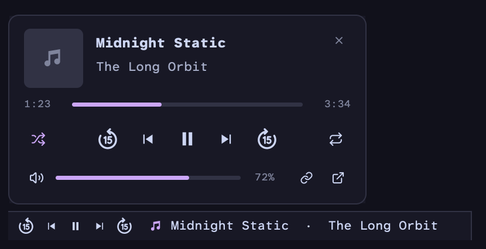

# Spotify mini

A tiny Spotify player for the Herdr app. In a thin layout block, such as a status bar, it shows the current track with −15s, previous, play/pause, next and +15s buttons. Clicking the track opens a popup just above it with the cover art, a seekable progress bar, shuffle, repeat, volume, Copy link and Open in Spotify. It controls the Spotify desktop app on macOS and never launches Spotify by itself.



## What you see

- **Bar item**, made for a 28px block about 440px wide. Its background is `chrome`, with a 1px `border` line on top and on the right. From left to right:
  - Five 22px round buttons, shown only while a track is loaded: −15s and +15s are a circular arrow with `15` inside at 17px; previous and next are 11px; play/pause is 12px. Each has a `hover` background.
  - A 22px-high clickable area (radius 4, `hover` background) holding a 13px Spotify logo (`accent` while playing, else `dim`) and `<track>  ·  <artist>` in `foreground` 11.8, truncated. Without a track it reads `Spotify isn't running`, `Nothing playing` or `Can't reach Spotify` in `dim`.
- **Popup**, 340×180, `popover` background, 14px by 12px padding, 8px gaps:
  - 56px cover art (radius 6), or a `raised` square with a note icon. Beside it, the track in semibold 13 `foreground` and the artist (or the album, for podcasts and audiobooks) in 12 `muted`. A 22px ✕ in `dim` sits at the top right.
  - Elapsed and total time in 10 `dim` around a 4px progress bar: `raised` track, `accent` fill.
  - Shuffle on the left and repeat on the right (28px, `accent` when on), around 34px −15s (22px icon), previous, play/pause (20px), next and +15s.
  - A mute or unmute button, a 4px volume bar, the volume as a percentage, then Copy link (a check in `accent` for 1.5 seconds after copying) and Open in Spotify.

## How it behaves

- The bar item reads Spotify every 2.5 seconds, the open popup every second, and both read again right after any control.
- Every button acts on Spotify at once: play/pause, previous, next, and ±15 seconds (never below 0).
- Clicking the track text opens the popup with its left edge on the bar item's and its bottom 6px above it.
- The ✕, Esc, or any press outside closes the popup. Pressing the track text while the popup is open just closes it.
- Clicking the progress bar seeks to that point; clicking the volume bar sets Spotify's volume (0–100). Mute sets the volume to 0 and unmute restores the last level (50 if none).
- Shuffle and repeat toggle Spotify's own settings. AppleScript has no "repeat one", so repeat is on or off.
- Copy link writes `https://open.spotify.com/<type>/<id>` from the track's `spotify:<type>:<id>` URI.
- Open in Spotify brings the Spotify app to the front.
- `mod.open {name: "spotify-mini"}` (the palette) opens the popup at the pointer instead.

## Built from

- `mods/spotify-mini/main.js`: one mod for both views. A copy with `props().overlay` draws the popup; any other copy draws the bar item. Herdr functions: `exec`, `props`, `theme`, `appHome`, `openOverlay`, `closeOverlay`, `shared`, `setShared`.
- `mods/spotify-mini/mod.json`: `{ "place": "none", "title": "Spotify", "overlay": { "kind": "popup", "width": 340, "height": 180 } }`.
- Programs:
  - `osascript` against the Spotify app. It reads `player state`, `shuffling`, `repeating`, `sound volume`, `player position`, and the current track's `name`, `artist`, `album`, `artwork url`, `duration` and `spotify url`, separated by `character id 31`.
  - It runs `playpause`, `previous track`, `next track` and `activate`, and sets `shuffling`, `repeating`, `sound volume` and `player position`.
  - `sh` with `curl` saves cover art to `cache/spotify-mini/<id>.jpg` under the app folder.
- The bar opens the popup with `openOverlay({ mod: "spotify-mini", kind: "popup", width: 340, height: 180, at })`. `at` comes from the bounds that the bar's `on_mouse_down` reports.
- Icons, all tinted SVGs: `spotify`, `note`, `play`, `pause`, `prev`, `next`, `back15`, `fwd15`, `close`, `shuffle`, `repeat`, `volume`, `mute`, `link`, `check`, `open`. `back15` and `fwd15` draw the `15` as strokes, not text. The last seven follow Lucide. `spotify` is the Spotify mark from Simple Icons.
- Props `{ "demo": true }` show a sample track ("Midnight Static" by "The Long Orbit") and never call Spotify. Add `"view": "preview"` to draw the popup above the bar, as in `preview.png`.

## Use it in a layout

Copy `mods/spotify-mini/` to `~/.config/herdr-app/mods/`, then give it a block. For the left end of a 28px status bar:

```json
{ "id": "status-row", "type": "row", "size": { "px": 28 }, "resizable": false,
  "children": [
    { "id": "spotify", "type": "block", "size": { "px": 440 }, "content": { "mod": "spotify-mini" } },
    { "id": "status", "type": "block", "content": { "mod": "workspace-status" } } ] }
```

## Watch out

- macOS only; it needs the Spotify desktop app. The first control may make macOS ask to let Herdr control Spotify.
- It checks `application "Spotify" is running` before anything else, so polling never starts Spotify.
- Cover art lives outside `mods/`, because saving a file in a mod folder reloads the mod.
- A popup taller than its content draws shorter than the requested `height` and then floats above the bar. Keep `height` at the content's 180px.
- A mod's `close()` isn't a reliable signal that a popup closed, so it doesn't track "is open" in shared state. Instead the popup stamps `shared("spotify.popupClosedAt")` from `on_mouse_down_out`, and the bar ignores a click within 600ms of that stamp.
- Spotify's AppleScript can't like, save, queue or pick devices (`starred` is read-only). Those need the Spotify Web API.

## Done when

- `herdr-app check mods/spotify-mini` passes.
- With Spotify playing, the bar shows the five buttons and `<track>  ·  <artist>`, and play/pause pauses it.
- +15 moves the elapsed time forward 15 seconds; −15 at 0:05 goes to 0:00.
- Clicking the track opens the popup right above the bar with the cover art and a moving clock, and its ✕ closes it.
- Clicking the middle of the progress bar seeks to about half the track, and the volume bar sets Spotify's volume.
- Copy link puts an `open.spotify.com` link on the clipboard.
- With Spotify quit, the bar reads `Spotify isn't running` and Spotify stays closed.
- `{ "demo": true, "view": "preview" }` in a mod pane draws the popup above the bar with the sample track.
